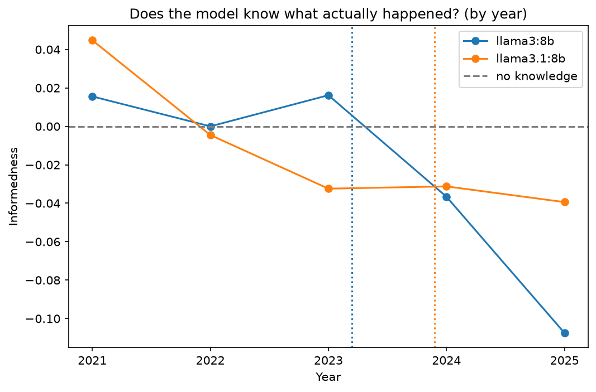

# LLM Look-Ahead Bias in Trading Backtests

LLMs are trained on historical market data, so backtests that use them can
quietly "predict" events they already saw. This project measures that effect.

## Key finding
Both models track real stock moves on dates they saw in training and lose
that ability after their training cutoff (z = 3.9 and 3.3). But the signal
comes entirely from **year-level hindsight**: both models answered DOWN to
essentially every 2022 question (0–0.3% UP vs. 38% actual), yet within any
single year they could not tell which stocks went up. An LLM-driven backtest
over 2022 would look brilliant because the model already knew it was a bear
market, not because it can forecast.

## Method
- Two local models from the same family with different training cutoffs:
  Llama 3 8B (Mar 2023) and Llama 3.1 8B (Dec 2023), run via Ollama
- 1,800 questions per model: 30 large-cap stocks x 60 months (Jan 2021 – Dec 2025)
- System prompt framing the model as a financial historian; user prompt:
  "Was [TICKER] stock up or down in [MONTH YEAR]? Respond in JSON."
- Answers forced to UP/DOWN with JSON-schema constrained decoding; temperature 0
- Ground truth: split/dividend-adjusted monthly returns from yfinance
  (54.4% of stock-months were UP)
- Primary metric: informedness (Youden's J) = P(says UP | actually UP) −
  P(says UP | actually DOWN). It is 0 for a model with no knowledge,
  regardless of whether it leans UP or DOWN.
- Prompt locked before the full run by answer balance only
  (accuracy never examined), to avoid tuning toward a result

## Results

Before vs. after each model's training cutoff:

| Model | Period | n | Said UP | Accuracy | Informedness (SE) |
|---|---|---|---|---|---|
| Llama 3 | before | 810 | 28.3% | 55.4% | **+0.121** (0.031) |
| Llama 3 | after | 990 | 59.1% | 48.7% | −0.052 (0.031) |
| Llama 3.1 | before | 1,080 | 28.0% | 53.0% | **+0.087** (0.027) |
| Llama 3.1 | after | 720 | 85.6% | 52.6% | −0.037 (0.026) |

Before/after gap: **Llama 3: 0.173 (z = 3.9); Llama 3.1: 0.124 (z = 3.3)**

Accuracy alone hides this: Llama 3.1's accuracy is ~53% in both periods.

Within each year, informedness is ~0 for both models (all within about
±0.05, roughly one standard error). The pooled "before" signal comes from
the models' answers shifting with each year's overall market direction:

| Year | Actually UP | Llama 3 said UP | Llama 3.1 said UP |
|---|---|---|---|
| 2021 | 61.1% | 61.7% | 59.2% |
| 2022 | 38.3% | **0.0%** | **0.3%** |
| 2023 | 60.0% | 23.9% | 24.4% |
| 2024 | 59.4% | 71.1% | 84.4% |
| 2025 | 53.1% | 69.4% | 86.7% |

## Findings
- **Year-level, not stock-level, hindsight.** Models know 2022 was a bear
  market and answer DOWN to nearly everything, but show no skill at
  telling stocks apart within a year. This is a Simpson's-paradox pattern:
  the pooled effect disappears inside each year.
- **No extra 2023 knowledge for Llama 3.1**, despite training through
  Dec 2023. Both models treated 2023 like 2022 (~24% UP vs. 60% actual).
- **Optimism about the unknown:** on post-cutoff dates both models
  default to UP (69–87%).
- **Refusal confound:** without constraints, models refused questions about
  recent dates, which would have faked a look-ahead effect; fixed with
  constrained decoding.
- **Prompt sensitivity:** adding "Give your best guess" pushed both models
  toward DOWN (UP answers rose from under 15% to ~37% of a test sample
  when removed).

## Limitations
- Survivorship bias: all 30 stocks are still large today
- Single prompt template; 8B models only
- Year-level hindsight means pooled before/after comparisons overstate
  stock-level skill; within-year analysis is needed
- One yearly value (Llama 3, 2025: −0.108) is ~2 SE from zero; with 10
  yearly estimates, one such value is expected by chance

## Next steps
- Within-month analysis to test for month-level (not just year-level) hindsight
- Swap answer order ("DOWN or UP") to test position bias
- Hide tickers and dates to separate memory from reasoning
- Measure refusal rate by month without forced answers
- Add more model families with known cutoffs

## Run it
    pip install -r requirements.txt
    python src/get_prices.py
    python src/ask_models.py
    python src/analyze.py

Full experiment log: [LAB_NOTES.md](LAB_NOTES.md)